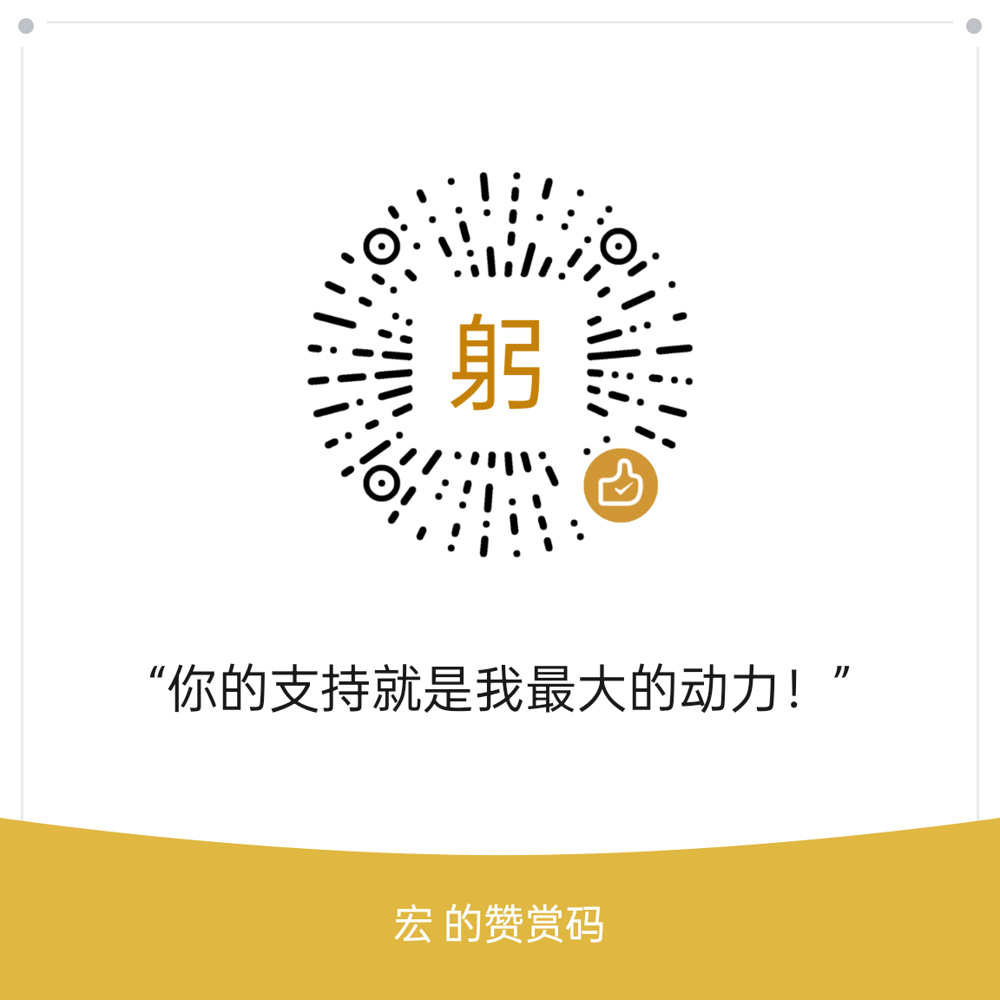

# 鸽子下载自用版（GeZi）

> 一个 Windows 桌面端的**夸克网盘下载器** —— 支持分享链接 / 网盘直链解析、
> 多线程分片下载、边下边播、多账号管理、深色模式。
> 基于 **.NET Framework 4.8 + WPF** 开发，**零 NuGet 依赖、可完全离线构建**。

<p align="center">
  
</p>
<p align="center">
  
  
  
  
</p>

---

## ✨ 功能特性

### 下载
- **独立分片 + 顺序合并**：每个分片独立文件，**可边下边播**
  （早期版本还有"多线程共写同一文件"模式，因机械盘寻道导致 100% 磁盘占用已移除）
- **高并发分片下载**：片数按文件大小自动计算（≥ 有效并发 × 8，上限 4096），
  单文件最多 **512** 个并发连接
- **连接数按文件大小比例分配**：大文件多给连接，小文件不浪费
- **暂停 / 续传**：断点续传，重启后自动恢复未完成任务
- **直链失效自愈**：直链带时效签名，中途过期会自动换一条新链接着下
- **中转副本没了也能续**：转存下载的文件若中转副本被删除，会自动回到分享里
  重新定位源文件、改走免转存继续下
- **限速自适应**：被服务端限流时自动退避，空闲后自动恢复
- **取消即清理**：取消任务会立刻删除本地残留（想保留进度请用「暂停」）

### 解析与登录
- **分享链接解析**：支持夸克分享链接（含带口令的链接）
- **剪贴板自动解析**：在任何程序里复制到夸克分享链接，本程序就自动解析并载入文件列表
  （默认开启，设置页「剪贴板」可关）
- **解析历史**：按 `h`（或点文件区工具栏的「解析历史」）唤出居中面板，按 今天 / 昨天 / 更早
  分组，点一条即可重新打开那个分享；右键条目可**置顶 / 删除**
- **免转存直链**：文件右键可选「免转存下载」，不占用网盘空间
- **二维码识别**：分享页只给二维码图片时，可截图识别（Ctrl+V / 选文件 / 拖拽）
- **扫码登录**：通过内置的 OpenSSL 通道完成扫码登录与账号信息获取
  （夸克按 TLS 指纹过滤，只有 OpenSSL 3.5.7 能过那道墙，详见「技术说明」）
- **多账号**：可保存多个账号，一键切换

### 体验
- **键盘快捷键**：`1/2/3` 切到下载/任务/登录、`q` 设置、`6` 关于、`h` 解析历史；
  `a` 返回上级、`d` 免转存下载、`x` 下载选中、`g` 获取直链、`s` 多选、`r` 刷新
  （完整列表在设置页最下方「快捷键」一节）
- **大目录不卡**：目录按页加载 —— 一次只渲染 10 条，滑到底部自动续上
- **顺手的目录操作**：单击文件夹即进入；顶部路径条每一节都能点击跳转
- **边下边播**：未下完也能用 VLC 播放已下载部分
- **深色模式**：亮色 / 深色 / 跟随系统
- **托盘常驻 + 悬浮小窗**：关掉主窗口也继续下载
- **任务列表好找事**：可按「失败 / 未完成 / 已完成」分层排序，失败的任务排在最前方便重试；
  失败的任务也能用「全部恢复」一次性批量重试
- **完成后自动关机**：可开启，全部下载完成后弹 15 秒倒计时确认框，
  不操作则自动在 1 分钟内关机
- **导出直链**：纯直链 / curl / aria2c 三种格式
- **拖拽添加**：支持拖拽链接、文件到窗口

---

## 🖥 系统要求

| 项 | 要求 |
|---|---|
| 操作系统 | **Windows 10 1903+ / Windows 11**（推荐）<br>Windows 8.1 / Windows 7 SP1 理论可用，需自行安装 .NET Framework 4.8 |
| 运行时 | **.NET Framework 4.8**（Win10 1903 起系统内置） |
| 播放器（可选） | **VLC** —— 仅边下边播功能需要 |
| 架构 | x64 |

> ⚠️ **本软件仅支持 Windows**，不支持 Linux / macOS。
> （UI 基于 WPF、运行时为 .NET Framework，两者均为 Windows 独占。）

---

## 🚀 使用

### 方式一：下载发行版（推荐）

1. 从 [Releases](https://github.com/zeroyong/gezi-quark-downloader-main/releases) 下载 `GeZi-v2.8.1-win64.zip` 并解压到任意目录
2. 双击 `GeZi.exe` 即可运行
3. 若系统缺少 .NET Framework 4.8，Windows 会弹窗提示，按引导安装即可

> **免安装、免 Python**：解压即用。安装包约 **3 MB**（含 OpenSSL 与 ZXing 两个原生库），
> 只含运行必需的文件 —— 调试符号、账号配置一律不进包。

### 方式二：从源码构建

```bash
# 1. 克隆仓库
git clone https://github.com/zeroyong/gezi-quark-downloader-main.git
cd gezi-quark-downloader-main

# 2. 构建（Release）
dotnet build src/GeZi/GeZi.csproj -c Release

# 3. 运行
src/GeZi/bin/Release/net48/GeZi.exe
```

> ⚠️ 建议直接编 `src/GeZi/GeZi.csproj`。仓库里的 `GeZi.slnx` 是新的 XML 解决方案格式，
> 需要 **.NET SDK 9.0.200+**；用较老的 SDK 或只装了 MSBuild 的机器会打不开它。

**无需 `nuget restore`** —— 本项目零 NuGet 依赖，所有第三方库以固化 DLL 形式随仓库分发，
任何机器 clone 下来即可直接构建（需已安装 .NET Framework 4.8 开发包 / MSBuild）。

### 自己打包

```powershell
# 产出 dist/GeZi-v<版本>-win64.zip（只含运行必需文件，体积最小）
powershell -NoProfile -ExecutionPolicy Bypass -File .\tools\package.ps1
```

> ⚠️ 打包**不会**把 `GeZi.config.xml`（含登录 Cookie）与 `accounts/`（账号档案）
> 放进 zip —— 那是本机隐私。如果想要带登录态的便携版，把这两个手动拷到解压目录即可。

---

## 🔄 更新（内置双源回退）

程序内置「检查更新」，**无需手动找下载页**：在「关于」页或设置页点「检查更新」，
发现新版本会弹出详情窗，提供两种动作：

- **一键更新**（主按钮）：自动下载安装包 → 解压 → 外部脚本覆盖 → 重启，
  全程无需手动操作（来源支持自动安装时可用）。
- **查看详情**：在浏览器打开来源页，手动下载安装包。

更新源采用**双源回退**，优先 GitHub、GitHub 不可达时回退到夸克网盘分享：

| 源 | 地址 | 说明 |
|---|---|---|
| GitHub Releases（主） | `https://github.com/zeroyong/gezi-quark-downloader-main/releases` | 标准 Release，直链下载 |
| 夸克网盘分享（回退） | `https://pan.quark.cn/s/065af2172c40`（提取码 `VD8m`） | 分享内 `GeZi-vX.Y.Z-win64.zip` |

双源并发检查，取**版本号更高者**；版本相同时优先 GitHub。无论是哪个源，更新都**不会回退到更低版本**。
当前应用版本号从程序集读取（如 `2.8.1`），更新检测据此判断是否有新版本。

> 说明（方案选择）：一键更新采用「解压覆盖 + 外部小脚本接力」的方式 —— 主进程先退出，
> 再由 `gezi-updater.cmd` 用 `xcopy` 覆盖文件并拉起新版本，避免「程序自我覆盖」的占用冲突。

---

## 🔧 技术说明

**为什么内置了 OpenSSL？**
夸克的 `pan.quark.cn` 前置 ALB 按 **TLS ClientHello 指纹**过滤，只放行 ClientHello
足够"大"的客户端。实测（均强制直连）：

| TLS 实现 | 能否访问 `pan.quark.cn` |
|---|---|
| SChannel（.NET HttpClient / Windows curl） | ❌ 连接被重置 |
| OpenSSL 3.0.18（系统 Python 3.14 的 ssl） | ❌ 连接被强制关闭 |
| BouncyCastle 2.7（纯托管 TLS） | ❌ 同上 |
| **OpenSSL 3.5.7（项目内置）** | ✅ HTTP 200 |

因此扫码登录（换登录态）与取账号昵称头像只能走 OpenSSL 这条路。
它是**唯一**的通道，删不得 —— 但压缩后只占约 2 MB，整个安装包仍只有 3 MB。

**为什么曾经内置 Python？**
早期版本用"起一个 CPython 子进程跑 .py"的方式做这件事，代价是包体积 +11 MB，
而且带着「解释器 + 脚本 + 子进程」这组特征 —— 实测被杀毒软件误判。
现在改成 P/Invoke 直调 OpenSSL，**TLS 指纹完全一致，但不再需要解释器**。

---

## 🧱 项目结构

```
GeZi/
├── src/
│   ├── GeZi/                     # 主程序（WPF 界面层）
│   │   ├── MainWindow.xaml(.cs)  # 主窗口
│   │   ├── Resources/            # 主题色、样式、图标
│   │   │   ├── Colors.Light.xaml # 亮色配色（36 个键）
│   │   │   ├── Colors.Dark.xaml  # 深色配色（与亮色键一一对应）
│   │   │   └── ...
│   │   └── ...
│   └── GeZi.Core/                # 核心逻辑（无 UI 依赖，可单独复用）
│       ├── Api/                  # 夸克 API 客户端
│       ├── Download/             # 分片下载引擎
│       ├── Support/              # 二维码编解码、OpenSSL 通道等工具
│       ├── lib/ZXing/            # 固化的 ZXing DLL（二维码解码）
│       └── lib/OpenSSL/          # 固化的 OpenSSL 3.5.7（扫码登录通道）
├── tools/
│   └── package.ps1               # 打包脚本（产出最小体积的发布 zip）
├── LICENSE                       # GPL-3.0
└── THIRD-PARTY-NOTICES.md        # 第三方组件声明
```

---

## 📜 许可证

本项目以 **GNU General Public License v3.0** 发布，详见 [LICENSE](LICENSE)。

```
Copyright (C) 2026  Yi Yuan

This program is free software: you can redistribute it and/or modify
it under the terms of the GNU General Public License as published by
the Free Software Foundation, either version 3 of the License, or
(at your option) any later version.

This program is distributed in the hope that it will be useful,
but WITHOUT ANY WARRANTY; without even the implied warranty of
MERCHANTABILITY or FITNESS FOR A PARTICULAR PURPOSE.  See the
GNU General Public License for more details.
```

这意味着：你可以自由使用、修改、分发本软件，
但**任何分发（含修改版）都必须同样以 GPL-3.0 开源**，并提供完整源代码。

### 第三方组件

本项目使用了以下第三方开源组件，详见 [THIRD-PARTY-NOTICES.md](THIRD-PARTY-NOTICES.md)：

| 组件 | 许可证 |
|---|---|
| ZXing.Net | Apache-2.0 |
| OpenSSL | Apache-2.0 |

---

## ⚠️ 免责声明

1. 本项目**仅供学习与技术研究**使用。
2. 本项目通过调用**夸克网盘的非公开接口**实现功能，可能随服务端变更而失效。
3. 请勿将本软件用于**商业用途**，或用于**侵犯他人版权 / 违反服务条款**的行为。
4. 使用者应自行承担因使用本软件产生的一切后果，作者不承担任何责任。
5. 下载的内容版权归原权利人所有，请遵守相关法律法规。

---

## 🙏 致谢
感谢 [ZXing.Net](https://github.com/micjahn/ZXing.Net/) 提供的二维码解码能力，
以及 [OpenSSL](https://www.openssl.org/) 项目。

本项目基于 [huaotem-bot/gezi-quark-downloader](https://github.com/huaotem-bot/gezi-quark-downloader)
二次开发（GPL-3.0 允许，原版权与许可声明见 [LICENSE](LICENSE)）。

开发过程中参考了若干开源下载器的公开文档与设计思路（未复制其源代码），
在此一并致谢，详见 [THIRD-PARTY-NOTICES.md](THIRD-PARTY-NOTICES.md) 第 5 节。

---

## ☕ 赞赏支持
如果这个项目对你有帮助，欢迎请作者喝杯咖啡 ☕

<p align="center">
  
</p>
